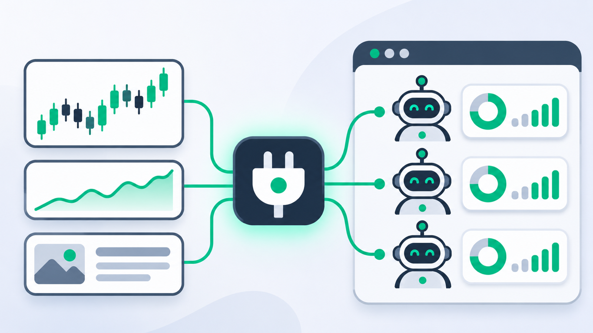

<h1 align="center">Agent Trade</h1>

<p align="center"><b>An MCP server that gives AI assistants stock market data and financial news.</b></p>
<p align="center">Plug it into Claude Code, Cursor, or any MCP client — and explore multi-agent paper-trading experiments in a local web UI.</p>

<p align="center">
  
  
  
</p>

<p align="center">
  
  <br>
  <sub><i>Market data and news in, agent decisions out.</i></sub>
</p>
<!-- TODO: generate docs/hero.png from docs/hero-image-prompt.md -->

## Features

- **Stock data** via yfinance: current price and company info, historical OHLCV, dividend history, stock splits.
- **News** via Tiingo (ticker-specific) and NewsAPI (keyword search).
- **Works with any MCP client**: Claude Code, Cursor, and others, over a standalone FastMCP server.
- **Claude Code automation**: `agent-trade-claude` drives the Claude Code CLI with access to all your skills and MCP servers.
- **Multi-agent experiments**: `agent-trade-experiment` creates experiments with several agents, each starting with its own capital, which make trading decisions day by day.
- **Local web UI**: a React app for visualizing and controlling those experiments.
- **Tool usage logs**: `agent-trade-logs` shows tool-call logs and statistics.

## Available tools

| Tool | Source | Description |
|------|--------|-------------|
| `get_stock_info` | yfinance | Current price and company information |
| `get_historical_prices` | yfinance | Historical OHLCV price data |
| `get_dividend_history` | yfinance | Dividend payment history |
| `get_stock_splits` | yfinance | Stock split history |
| `get_stock_news` | Tiingo | Financial news for specific tickers |
| `search_news` | NewsAPI | General keyword news search |

## Get started

Requires Python 3.10+ and [uv](https://docs.astral.sh/uv/).

```bash
git clone git@github.com:scalefreegan/agent-trade.git
cd agent-trade

uv sync                    # core MCP server
uv sync --extra agent      # optional: Claude Agent / experiment CLI
uv sync --extra web        # optional: web UI backend
```

Configure your API keys:

```bash
cp .env.example .env
```

```
TIINGO_API_KEY=your_tiingo_api_key
NEWSAPI_KEY=your_newsapi_key
```

Get keys from [Tiingo](https://www.tiingo.com/) and [NewsAPI](https://newsapi.org/).

## Usage

There are two modes of operation.

### Mode 1: MCP server (Claude Code, Cursor)

Run the server:

```bash
uvx --from . agent-trade        # no install needed
uv run agent-trade              # after uv sync
uv run fastmcp dev agent_trade.server:mcp   # development mode with FastMCP
```

**Claude Code** — add to your MCP config:

```json
{
  "mcpServers": {
    "agent-trade": {
      "command": "uvx",
      "args": ["--from", "/path/to/agent-trade", "agent-trade"],
      "env": {
        "TIINGO_API_KEY": "${TIINGO_API_KEY}",
        "NEWSAPI_KEY": "${NEWSAPI_KEY}"
      }
    }
  }
}
```

If installed globally, use `"command": "agent-trade"` and omit `args`.

**Cursor** — add to Settings > MCP:

```json
{
  "agent-trade": {
    "command": "uvx",
    "args": ["--from", "/path/to/agent-trade", "agent-trade"],
    "env": {
      "TIINGO_API_KEY": "your_key_here",
      "NEWSAPI_KEY": "your_key_here"
    }
  }
}
```

Then try prompts like:

- "What is AAPL trading at?"
- "Get the historical prices for TSLA over the last 3 months"
- "Search for news about Federal Reserve interest rates"
- "What dividends has Microsoft paid in the last year?"

### Mode 2: Automate the Claude Code CLI

With the MCP server configured in Claude Code, query through it from the command line, with access to all of Claude Code's tools and skills:

```bash
agent-trade-claude query "What is AAPL trading at?"
agent-trade-claude query "Get historical prices for TSLA"
```

This requires Claude Code to be installed and configured. See [USAGE_MODES.md](USAGE_MODES.md) for details.

## Multi-agent experiments and web UI

Experiments are created from the CLI and viewed in the web UI.

```bash
uv sync --extra agent

# Create an experiment (defaults: 10 agents, $1,000 each)
agent-trade-experiment init --name "Q1-2026"
agent-trade-experiment init --name "Test" --agents 5 --capital 500

# Run a trading day (agents make decisions and execute trades)
agent-trade-experiment run default      # "default" = most recent experiment, or pass an ID
```

Then start the web UI:

```bash
make web-install    # one-time: uv sync --extra web + npm install in web/
make web            # runs backend and frontend together (Ctrl+C stops both)
```

Or run them separately with `make web-backend` and `make web-frontend`. The backend serves on <http://localhost:8000>; open the frontend at <http://localhost:5173> (Vite proxies `/api` to the backend).

`TIINGO_API_KEY` and `NEWSAPI_KEY` are optional for experiments but supply market data and news.

## Development

```bash
uv sync
uv run pytest
uv run ruff format .
uv run ruff check .
```

## License

MIT
